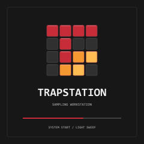

<p align="center">
  
</p>

<p align="center"><b>Trap Station Desktop</b><br>
the computer side of <a href="https://github.com/sog-maker/trapstation-os">TRAPSTATION OS</a> on the M-VAVE FM-1:
samples, the factory banks, a live screen, and your jam as an Ableton Live project</p>

<p align="center">
  
  
  
  <a href="LICENSE"></a>
</p>

<p align="center">The firmware, its installer and its user guide:
<a href="https://github.com/sog-maker/trapstation-os">sog-maker/trapstation-os</a> ·
install TRAPSTATION OS in the browser: <a href="https://sog-maker.github.io/trapstation-os/">the online installer</a></p>

## What it does

| | |
| --- | --- |
| **Converter** | WAV, MP3, FLAC, OGG, M4A, AIFF and more into sample data for the FM-1 (an Opus copy is kept in the archive) |
| **Sampler S01–S32** | puts converted samples onto the FM-1; the sample memory is read first, so the samples already there stay |
| **Banks A–E** | the 40 factory presets of TRAPSTATION OS with all their values |
| **Device view** | the FM-1's screen, live, on the computer |
| **Arrangement** | the four scenes with the tracks that play in them; double-click a clip for the piano roll or the drum sequencer |
| **Ableton export** | an Ableton Live project (`.als`), one MIDI track per track and the clips at their scene positions; or one MIDI file per scene |

## Status of this build

**Version 0.1.1, for TRAPSTATION OS 1.0.0.0** (identity `FM-1_510`). The factory banks in the app are those of 1.0.0.0,
and the app finds the FM-1 under its 1.0 name, TRAPSTATION FM-1.

**Works with the device**

- Reading and writing the sample memory (S01–S32), with the other samples kept
- Reading the sound and kit slots, the last jam and the scenes
- The live screen mirror
- Writing an imported sound into a user sound slot, after a backup and your confirmation (the FM-1 restarts)

**Only in the app, not written to the device**

- Editing the factory banks A–E: a local copy for looking and trying; the FM-1 keeps its factory banks
- Editing clips in the arrangement, the piano roll and the drum sequencer: they change the Ableton export only. The
  firmware stores one pattern per track, not one per scene

**Not in this build yet**

- Installing or updating the firmware, backups of the whole device and the factory reset: use the
  [online installer](https://sog-maker.github.io/trapstation-os/) for those
- The new controls of 1.0 (Piano Roll OCT+ + K1, the sequencer's PLAY bar and COPY TO, PERFORMANCE): they are played on
  the device; the app does not show or edit them
- SLICE settings of a sample: kept with the last jam on the device, not shown in the app
- macOS and Linux

Every function of this build has been tested on a FM-1 with TRAPSTATION OS 1.0.0.0. If something does not work for
you, open an [issue](https://github.com/sog-maker/trapstation-desktop/issues) with what you did and what the app said.

## Download

From the [latest release](https://github.com/sog-maker/trapstation-desktop/releases/latest):

- `Trap Station Setup 0.1.1.exe`: the installer (Windows may warn that it is not signed: More info > Run anyway)
- `Trap Station-0.1.1-win.zip`: the program without installing, for `scripts/install.ps1` (below)

## Requirements

- Windows 10 or 11
- TRAPSTATION OS 1.0.0.0 on the FM-1 ([install it here](https://sog-maker.github.io/trapstation-os/))
- [ffmpeg](https://ffmpeg.org/) with libopus, on the `PATH`, for the converter
- Python 3.10 or newer (standard library only), for the Ableton export
- A USB data cable, the FM-1 straight into the computer, other music apps closed

## Run from source

```bash
npm install
npm start
```

## Build the installer

```bash
npm run dist
```

This creates `dist/Trap Station Setup 0.1.1.exe` (an installer) and `dist/Trap Station-0.1.1-win.zip`. The Ableton
tools go along as extra resources next to the program.

## Install with PowerShell

```powershell
powershell -ExecutionPolicy Bypass -File .\scripts\install.ps1 -Zip ".\dist\Trap Station-0.1.1-win.zip"
```

The script unpacks the program to `%LOCALAPPDATA%\Programs\Trap Station` and adds a Start menu and a desktop shortcut.

## Where files are stored

- Device backups and the Opus archive go to the app's user data folder (from source: `Sicherungen/` and `Opus-Archiv/`
  in the project folder).
- The Ableton export uses the `ableton/` folder; set `TRAP_ABLETON_DIR` for another one.

## Safety

Before anything is written to the device, the object it changes is backed up. Writing is limited to the sample memory
and to user sound slots, and always asks first.

## Limits

- The values of an imported preset (Vital) are approximations. Listen to the result on the device.
- The Ableton export uses the template's drum rack for the MIDI tracks; the other tracks come without an instrument.
- Phaser and bitcrush are not part of the firmware, so they are not in the app.

## License

GPL-3.0-only, see [LICENSE](LICENSE).

- The modules in `web/` (sample upload, update transfer, sample memory image) come from
  [TRAPSTATION OS](https://github.com/sog-maker/trapstation-os), based on BBL JAM BOX (Blair) and Felucca (Leo Kuroshita,
  Hügelton Instruments); their copyright notices are kept.
- `ableton/render_scenes.exe` is a host build of the TRAPSTATION OS sequencer and engines. Its source is
  `tools/render_scenes.c` with `web/emu/felucca_web.c` in [TRAPSTATION OS](https://github.com/sog-maker/trapstation-os)
  (see its `docs/developer`).
